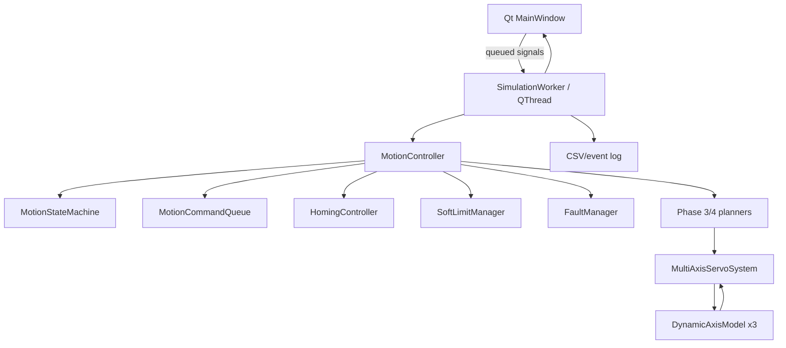

# MotionCore 软件架构

## 总体架构

核心库 `motioncore` 不依赖 Qt。GUI 只在 `MOTIONCORE_BUILD_GUI=ON` 时编译，使用快照和信号槽访问核心，因而无 Qt 环境仍能构建和执行核心 CTest。

## 模块职责

- `DynamicAxisModel`：保存单轴位置、速度、加速度并执行受限驱动力下的离散动力学。
- `PController`、`PIController`、`PIDController`：可复用控制器，管理输出/积分限幅和复位。
- `CascadedServoController`：外位置 P、内速度 P/PI，附加速度限幅、斜率限制和阻尼前馈。
- `TrajectoryProfile`、`TrapezoidalProfile`、`SCurveProfile`：标量轨迹解析采样。
- `LineInterpolator`、`ArcInterpolator`：把标量路径进度映射到 XYZ 几何状态，并检查曲率约束。
- `CoordinatedTrajectoryPlanner`、`MultiAxisServoSystem`：统一时间轴上的路径队列和三轴动力学闭环。
- `MotionController`：把状态、命令、回零、限位、故障、轨迹、伺服和日志串成单一调度器。
- `SimulationWorker`：在 Qt 工作线程中按 1 ms 步推进核心，GUI 按约 20 ms 接收只读 `GuiSnapshot`。

## 一个仿真周期

MotionController 的周期应保持统一：处理高优先级控制事件，确认状态和命令，生成当前参考，计算三轴控制输出，更新三个动力学轴，监控限位/故障，写入日志，再发布状态。三个轴共享同一仿真时间，不允许单轴提前结束造成时间错位。

GUI 的定时器只负责调用 worker；界面刷新频率和核心积分步长分离。Stop/EmergencyStop 通过 worker 线程排队到核心，核心仍负责最终权限检查。

## 指令数据流

绝对目标命令经过状态、回零和完整几何路径检查后进入 `MotionCommandQueue`。执行时记录 ID、状态、起止时间和错误码。拐角采用速度归零再切换的保守策略。EmergencyStop 和 Controlled Stop 走高优先级事件通道，不等待普通 FIFO 命令。

## 线程与生命周期

GUI 线程只读快照并更新控件；`MotionController` 只在 worker 所在线程调用。暂停不阻塞 Stop/EmergencyStop 的零时间优先事件路径；急停后 worker 继续推进禁能驱动的惯性尾段。窗口关闭前应停止定时器、请求 worker 退出并等待线程结束。Qt smoke/data/regression 测试在 `QT_QPA_PLATFORM=offscreen` 下覆盖对象创建、信号数据、暂停事件和连续队列，真实视觉操作需人工验收。

## 日志边界

实时绘图可保留有限窗口；完整 CSV 应由 worker 采样流写入或由核心日志保存，不能把绘图缓存上限当成实验数据上限。运动时间列使用仿真时间，未推进仿真时不生成新的运动采样。
